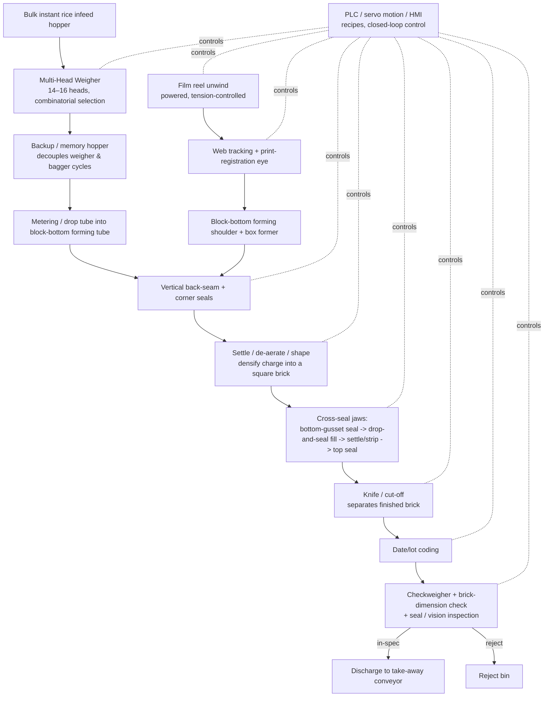

# Functional Requirement Specification (FRS)
## VFFS 1 kg Block-Brick Rice Packaging Machine with Multi-Head Weigher

| | |
|---|---|
| **Document** | Functional Requirement Specification + Engineering KPIs |
| **System** | Vertical Form-Fill-Seal (VFFS) bagger integrated with a Multi-Head Weigher (MHW) |
| **Product** | Dry parboiled / instant rice, **1 kg firm-fill block-bottom (quad-seal) brick** |
| **Revision** | Rev B — repositioned from 500 g pouch to 1 kg block brick |
| **Date** | 2026-09-08 |
| **Author** | Son Tung Dang |
| **Basis** | Project problem statement (Rev B) + study of 37 reference videos (Appendix A) + benchmarking (Appendix B) |
| **Status** | For review |

Note: 
- looking into the actual spec of the machine from the industrial standards.
- Moving average of _ (the number has to be actually calcualted for the response)
- update cycle for data logging
    - given the accuracy of the check weigher, how do to adjust the target to compensate for the accuracy, and what is the feedback frequency?
    - Given the accuracy (how much I s)

---

## 1. Introduction

### 1.1 Purpose
This document defines **what the machine must do** (functional requirements) and **how success is measured** (engineering KPIs) for a VFFS packaging machine paired with a multi-head weigher, dosing dry parboiled/instant rice and forming it into **1 kg firm-fill block-bottom "brick" bags**. It is written to be *testable*: every functional requirement is verifiable at Factory Acceptance Test (FAT) / Site Acceptance Test (SAT), and every requirement traces to an engineering objective and a KPI (Section 9).

This is a functional specification, not a mechanical detail design. It states required behaviour, performance, and interfaces; it does not fix specific part numbers, PLC brands, or GA drawings, which belong to the detailed-design phase.

### 1.2 Scope

**In scope (per problem statement):** film unwind, active web/registration tracking, **block-bottom** forming tube and shoulder, multi-head weigh discharge, **settling / densification / brick shaping**, film advancing, vertical (back) sealing, bottom-gusset sealing, horizontal (top) sealing, cutting, and discharge of finished bricks onto a downstream take-away conveyor. Control, dosing accuracy, brick form, seal integrity, changeover, and safety are treated as first-class functions.

**Out of scope:** cartoning / case packing, palletising, upstream rice storage and conditioning, and the downstream conveyor beyond the discharge hand-off point. These are defined only as **interfaces** (Section 6). **Vacuum** brick packing is explicitly excluded — this is a *firm-fill, atmospheric* brick densified by settling, not a vacuum brick.

### 1.3 Definitions and acronyms

| Term | Meaning |
|---|---|
| **VFFS** | Vertical Form-Fill-Seal — forms a tube from flat film around a forming shoulder, seals the back seam, cross-seals and fills, then cross-seals and cuts. |
| **Block-bottom / box-bottom** | A former/seal geometry that gives the bag a flat rectangular base and four crisp faces, so filled contents present as a square brick that self-stands. |
| **Quad-seal** | Bag with four vertical corner seals (plus bottom and top), giving sharp brick edges and printable side panels. |
| **Firm-fill brick** | Contents densified by vibratory settling / de-aeration (and optional tamping) into a dense, square block **at atmospheric pressure** — no vacuum. |
| **MHW** | Multi-Head Weigher — array of weigh heads that combinatorially selects buckets summing closest to target weight. |
| **bpm** | Bags (bricks) per minute — machine output rate. |
| **Cpk** | Process capability index; how well the fill distribution fits inside the tolerance band, accounting for off-centre mean. |
| **Giveaway** | Product delivered above the labelled/target weight; a direct material cost. |
| **OEE** | Overall Equipment Effectiveness = Availability × Performance × Quality. |
| **Drop-and-seal** | Synchronised cycle where the cross-seal jaws close and the metered charge drops in a timed sequence to keep product out of the seal zone. |
| **De-aeration** | Removing air entrained in the free-flowing charge by settling/vibration so the brick densifies and holds its shape. |
| **WVTR** | Water-Vapour Transmission Rate — barrier metric for the film (moisture ingress). |
| **SMED** | Single-Minute Exchange of Die — changeover-reduction methodology. |

### 1.4 Product and package definition

| Attribute | Value / requirement | Source |
|---|---|---|
| Product | Dry parboiled / instant rice, free-flowing, low-moisture | Problem statement |
| Bulk density | ≈ 0.75–0.85 g/cm³ (loose); densified by settling in-pack | Problem statement / §8.7 |
| Target fill weight | **1000 g** (labelled) | Problem statement |
| Operational weight band | **980–1020 g (±2.0 %)** | Problem statement |
| Design mean fill | **≈ 1002 g** (offset up to protect the lower spec limit while minimising giveaway) | Problem statement / analysis §8.2 |
| Fill volume (loose, at 0.80 g/cm³) | ≈ 1250 cm³ nominal (range 1176–1333 cm³ over the density band) | Derived §8.4 |
| Pack style | **Block-bottom / quad-seal brick**, self-standing, square edges, four printable faces | Problem statement |
| Brick dimensions (target) | ≈ 120 mm W × 150 mm H × 80 mm D (≈ 1440 cm³ gross; holds loose fill + settling headspace) | Derived §8.4 |
| Seal set | Back (fin/lap) + bottom-gusset + top cross-seal; airtight / hermetic, moisture barrier | Problem statement |
| Coding | Date/lot code on the brick (not a separate label) | Study (Appendix A #18, #36) |

---

## 2. System overview

### 2.1 Architecture
A single VFFS bagger fed by one multi-head weigher through a drop chute and a backup ("memory") hopper. The MHW meters each 1000 g charge; the VFFS forms a **block-bottom** tube, fills, **settles/densifies and shapes** the charge into a brick, seals (back, bottom-gusset, top), codes, cuts, and discharges the brick. A dynamic checkweigher, a brick-dimension check, and seal/vision inspection close the quality loop downstream of the bagger and gate a reject.

### 2.2 Material and process flow

### 2.3 Operating philosophy
- **Intermittent box-motion baseline** for the ≥ 25 bpm target and the 40+ bpm stretch. Block-bottom forming plus a settling/shaping dwell make the cycle longer than a plain 500 g pillow bag, so the rate band is lower; **continuous-motion / twin-former** architecture is the design path if the customer later targets > 45 bpm (Appendix A #10, #13; Appendix B).
- **Firm-fill by settling, not vacuum:** the brick is densified by vibratory settling / de-aeration (and optional tamping) at atmospheric pressure, then squared by a shaping frame before the top seal — giving a dense, self-standing brick without a vacuum station.
- **Weigh-then-verify:** the MHW achieves the statistical weight accuracy; a 100 % dynamic checkweigher is the hard backstop that guarantees no out-of-band brick reaches the customer, and an inline dimension check guards brick shape.
- **Mechanical seal protection for granular product:** because free-flowing grain cannot be reliably protected by servo "product-in-seal" *sensing* alone (that technique suits larger discrete items — Appendix B, Rovema), the primary defence is a **timed drop-and-seal cycle with stripper/settling plates** on **every** seal (bottom-gusset and top), clearing grain before clamp.

---

## 3. Operating requirements and design targets

| ID | Requirement | Target | Notes |
|---|---|---|---|
| OR-1 | Sustained output, baseline | **≥ 25 bpm** | Contractual baseline for a 1 kg block brick with settling/shaping. |
| OR-2 | Output, engineering stretch | **40+ bpm** | Achievable on high-end box-motion + servo + optimised settling. > 45 bpm ⇒ continuous-motion / twin-former. |
| OR-3 | Dosing capability | **Cpk ≥ 1.33** on net weight | Section 8.2. |
| OR-4 | Weight conformance | **100 %** of shipped bricks within 980–1020 g | Guaranteed by Cpk target + 100 % checkweigher rejection. |
| OR-5 | Mean fill | **≈ 1002 g** | Minimises giveaway (§8.3). |
| OR-6 | Brick form | Dense, square, self-standing brick within dimensional & density tolerance | Section 8.7, KPI §7.3. |
| OR-7 | Seal integrity | **Zero** grain entrapment in any seal; hermetic seal | Section 5, KPI §7. |
| OR-8 | Format range | 1 kg now; recipe-selectable across a ≈ 0.5–5 kg brick family | Study shows the platform runs 1 kg/2 kg and up to 10 kg (Appendix A #7, #11). |
| OR-9 | Availability | Design for ≥ 90 % availability, OEE ≥ 65 % (world-class ≥ 85 %) | Section 7. |

---

## 4. Functional requirements

Requirements use **shall** (mandatory), **should** (recommended), **may** (optional). IDs are stable references for the traceability matrix (Section 9).

### FR-1 — Film unwind and tension control
- **FR-1.1** The machine **shall** carry a powered film-reel unwind for reels up to the specified maximum OD and web width, with a spindle/chuck sized for the core.
- **FR-1.2** Web tension **shall** be actively controlled (dancer or load-cell feedback driving the unwind servo/brake) so tension stays within a set band across full-to-empty reel diameter, preventing neck-in, wrinkling, or seal-registration drift — important for the heavier/stiffer brick laminate (§8.6).
- **FR-1.3** The unwind **should** support a splice/near-end-of-reel warning so an operator can prepare the next reel without an unplanned stop (Appendix A #22, #23).
- **FR-1.4** Film threading path **shall** be clearly guided and accessible for the changeover method demonstrated in the reference set (roll-film setup, Appendix A #23).

### FR-2 — Web tracking and print registration
- **FR-2.1** The machine **shall** provide active lateral web guiding to keep the web centred on the forming shoulder within a specified tolerance.
- **FR-2.2** For pre-printed film, a registration photo-eye **shall** read the print (eye/registration) mark and correct film advance each cycle so artwork, corner seals, and cut fall in register within tolerance — critical because the brick has four printable faces that must align to the block edges.
- **FR-2.3** On loss of registration mark for N consecutive cycles, the machine **shall** alarm and stop in a safe, non-wasting state.

### FR-3 — Block-bottom forming tube and shoulder
- **FR-3.1** The forming shoulder and **block-bottom (box) former** **shall** form flat film into a rectangular tube with a flat base and defined corner geometry, sized to the target brick and fill volume (§8.4), producing a consistent back-seam overlap.
- **FR-3.2** The former **shall** produce sharp, repeatable corner folds/gussets so the filled, settled brick presents four flat faces and square edges (OR-6).
- **FR-3.3** The forming set **shall** be a changeable format part to support the brick-size family (OR-8); changeover **shall** follow a documented former-swap procedure (Appendix A #24).
- **FR-3.4** The tube **shall** present a clear internal path for the 1 kg metered charge to fall without bridging or grain hang-up.

### FR-4 — Product dosing (multi-head weigher)
- **FR-4.1** Dosing **shall** be by multi-head weigher using combinatorial selection of weigh-bucket contents to hit the 1000 g target with minimum deviation.
- **FR-4.2** Head count **shall** be selected to meet **Cpk ≥ 1.33 at ≈ 1002 g mean** at the required rate; **≥ 14 heads is required** and **16 heads is recommended** for headroom (benchmark: 16-head giveaway 0.4–0.8 %, 14-head 16,384 combinations/cycle — Appendix B). The larger 1 kg target makes the σ ≤ 4.51 g budget (§8.2) comfortably reachable.
- **FR-4.3** Load-cell/weigh-head resolution **shall** be ≤ ±1.0 g in the ~1 kg class (Appendix B), and the weigher **shall** auto-zero/auto-tare and auto-learn to hold accuracy against product-density drift.
- **FR-4.4** The weigher **shall** sustain a weighment rate that keeps the bagger fed at OR-1/OR-2 (a 10–14-head unit at ~30–60 weighments/min covers a 25–40 bpm bagger with margin — Appendix B).
- **FR-4.5** Contact surfaces (pans, buckets, chutes) **shall** be food-grade, smooth, and low-friction for free-flowing grain; radial feed-pan vibration amplitude **shall** be recipe-adjustable.
- **FR-4.6** The weigher **shall** flag and divert an out-of-tolerance combination rather than discharge it, and log the event.

### FR-5 — Transfer, buffering, settling, and brick forming
- **FR-5.1** A backup/memory hopper **shall** buffer at least one metered charge so the weigher cycle and bagger cycle are decoupled, protecting throughput (§8.5).
- **FR-5.2** The drop tube geometry and timing **shall** deliver the full charge into the tube **before** the top cross-seal, with a settling interval matched to free-flowing granules.
- **FR-5.3** The transfer path **shall** avoid grain ricochet toward the seal zone; a deflector/funnel into the tube is required.
- **FR-5.4** The machine **shall** provide **vibratory settling / de-aeration** of the charge in the formed tube to densify the rice into a firm, square brick and bring the fill height within tolerance (§8.7).
- **FR-5.5** The machine **should** provide optional **tamping / light compaction** to hit the target brick density and fill height when settling alone is insufficient, without crushing or fracturing grain.
- **FR-5.6** A **shaping frame / forming plates** **shall** square the brick (flatten faces, set width and depth) immediately before the top seal, so the finished brick meets the dimensional KPI (§7.3) and self-stands.

### FR-6 — Vertical (back-seam) and corner seals
- **FR-6.1** The machine **shall** produce a continuous, hermetic vertical back seam (fin or lap seal per film structure), plus corner seals as required for the quad-seal brick, with heater temperature, pressure, and dwell closed-loop controlled.
- **FR-6.2** Seal temperature **shall** be PID-controlled to set point with a documented tolerance; the seal system **shall** tolerate the brick film's seal window (Appendix A #6, #27).
- **FR-6.3** All longitudinal seals **shall** meet the seal-strength and hermeticity KPIs (Section 7) across the full speed range.

### FR-7 — Bottom-gusset and top (cross) seals — drop-and-seal, anti-entrapment
- **FR-7.1** The cross-seal jaws **shall** execute a synchronised **drop-and-seal** cycle: form the **bottom-gusset seal** → drop the metered charge → settle/densify → strip/clear the upper seal zone → close and seal the **top** of the current brick (which forms the base of the next).
- **FR-7.2** **Stripper / settling plates** **shall** clear grain from **every** seal band (bottom-gusset and top) immediately before jaw clamp, to achieve **zero grain-in-seal** (OR-7). This mechanical clearing is the primary defence for free-flowing grain (Appendix B); the brick's extra seams make it more important, not less.
- **FR-7.3** Jaw motion **shall** be servo-driven for repeatable, tunable close/dwell/open profiles and gentle-then-firm clamping (Appendix B: servo jaws reduce downtime ~30 % and improve OEE vs pneumatic; force to ~8000 N available).
- **FR-7.4** Cross-seal temperature, pressure, and **dwell** **shall** be recipe-controlled; the design **should** support twin-dwell or extended-jaw seals to hold hermeticity on the heavier brick laminate (§8.6).
- **FR-7.5** The machine **should** provide a means to detect product in the seal (e.g., seal-force monitoring) and mark/reject a suspect brick; for grain this augments — does not replace — FR-7.2.
- **FR-7.6** Seal profiles **shall** be knurled/serrated as required to bite through residual grain dust and guarantee an airtight closure.

### FR-8 — Cutting and brick separation
- **FR-8.1** A knife/cut-off **shall** separate finished bricks cleanly, mid-seal, leaving intact seals on both the finished and the following brick.
- **FR-8.2** The cutter **shall** be synchronised to the seal cycle and web advance, with no film jams at OR-2 rate.
- **FR-8.3** The design **may** support hole-punch, tear-notch, corner-seal trim, or an optional carry feature as format options (a 1 kg brick is easily one-hand-carried without a handle).

### FR-9 — Date/lot coding and marking
- **FR-9.1** The machine **shall** apply a legible date/lot code to each brick (thermal-transfer or inkjet), integrated with the seal/advance cycle (Appendix A #18, #36).
- **FR-9.2** Coding **shall** be driven from the recipe/lot data and **shall** be verifiable (vision read or coder feedback), with a no-code/bad-code reject.

### FR-10 — Discharge / downstream interface
- **FR-10.1** Finished, in-spec bricks **shall** discharge onto the take-away conveyor at the defined hand-off point without seal damage or loss of brick shape.
- **FR-10.2** Reject bricks (weight, dimension, seal, code, or vision failure) **shall** be diverted to a segregated reject bin, and the event logged.

### FR-11 — Control system
- **FR-11.1** A PLC with servo motion control **shall** coordinate unwind, web advance, weigher discharge, settling/shaping, seals, cutter, coder, and inspection in a single synchronised machine cycle.
- **FR-11.2** An HMI **shall** provide recipe management (film, brick size, temperatures, dwell, vibration/settle time, tamp force, timing), production counters, alarms with guided diagnostics, and role-based access.
- **FR-11.3** Recipes **shall** be storable/recallable so changeover to another brick in the family is a recipe recall plus format-part swap (OR-8).
- **FR-11.4** The controller **shall** run closed-loop temperature control on all seal heaters and **shall** accept checkweigher feedback to auto-trim the weigher target toward the giveaway-optimal mean (§8.3).
- **FR-11.5** The machine **shall** support a controlled start-up and shutdown that minimises film and product waste (empty-brick skip, seal-before-fill on start).

### FR-12 — Quality inspection (closed loop)
- **FR-12.1** A **100 % dynamic checkweigher** **shall** weigh every brick and reject any outside 980–1020 g (guarantees OR-4).
- **FR-12.2** The checkweigher **shall** feed net-weight statistics (mean, σ, Cpk, giveaway, trend) back to control and to the KPI dashboard.
- **FR-12.3** The machine **shall** include an inline **brick-dimension / squareness check** (e.g., profile sensor or vision) and reject soft or out-of-shape bricks (OR-6, §7.3).
- **FR-12.4** Seal integrity **shall** be monitored inline where feasible (seal-force/temperature logging per brick) and validated offline by the test methods in Section 10 (Appendix A #28, #32, #37).
- **FR-12.5** The machine **should** support optional vision inspection of seal band and code, and **may** support metal detection ahead of discharge.

### FR-13 — Changeover and format flexibility
- **FR-13.1** Format changeover (film reel, forming set, shaping frame, recipe) **shall** follow a documented SMED procedure with tool-light or tool-less format parts where practical (Appendix A #22, #23, #24).
- **FR-13.2** Changeover to another brick in the family **shall** meet the changeover-time KPI (Section 7).

### FR-14 — Safety and compliance
- **FR-14.1** All hot seal surfaces, the cutter, moving jaws, and the tamper/shaping mechanism **shall** be guarded; guards **shall** be interlocked so opening a guard removes hazardous motion/heat energy (category per risk assessment).
- **FR-14.2** The machine **shall** provide accessible E-stops that bring it to a safe state, and a lockout/tagout scheme for maintenance.
- **FR-14.3** Electrical, machinery-safety, and (as applicable) food-contact and hygienic-design standards **shall** be met per the destination market (e.g., machinery safety directive/standards, UL/CE controls, food-contact material compliance).
- **FR-14.4** Hot-surface and pinch-point hazards **shall** be labelled; a documented risk assessment **shall** support the guarding design.

### FR-15 — Hygienic design and sanitation
- **FR-15.1** Product-contact surfaces (including settling/tamping and shaping tooling) **shall** be food-grade, corrosion-resistant, and cleanable; no product traps.
- **FR-15.2** The weigher, product path, and shaping tooling **shall** be tool-lightly dismantlable for dry cleaning between products.
- **FR-15.3** Construction **shall** suit a dry, dusty (rice-dust) environment; electricals **shall** carry an appropriate ingress rating.

### FR-16 — Data, traceability, and connectivity
- **FR-16.1** The machine **shall** log per-lot: counts, mean/σ/Cpk, giveaway, brick-dimension results, rejects by cause, downtime by cause, and codes applied.
- **FR-16.2** The machine **should** expose OEE and the Section 7 KPIs on the HMI and via a standard interface (OPC UA / Ethernet-IP) to a line MES/SCADA.

---

## 5. Seal-integrity requirements (expanded)

Seal integrity is called out separately because it is both an explicit objective (OR-7) and the dominant quality risk for free-flowing grain — and the block brick has **more seams** (bottom-gusset + corner + top) than a pillow pouch, so there are more places for grain to be trapped. The reference set devotes ~10 videos to sealing science and testing (Appendix A #6, #14, #27–37), reflecting its weight.

**Design principles adopted:**
1. **Mechanical clearing first, on every seal.** Stripper/settling plates and a timed drop-and-seal keep grain out of the bottom-gusset and top seal bands (FR-7.1/7.2). Servo product-in-seal *sensing* is a secondary aid, not the primary control for grain (Appendix B, Rovema note).
2. **Right film for a fast, forgiving seal window.** A sealant layer (LLDPE/LDPE) that seals hot-tack fast at moderate temperature widens the process window and shortens dwell, protecting both hermeticity and throughput (Appendix A #27; §8.6).
3. **Hermetic, not merely strong.** A seal can pass a burst/strength test yet leak through a channel defect (Appendix B, FlexPak). Acceptance therefore requires **both** a strength test (ASTM F88) **and** a leak/integrity test (ASTM F2096 / D3078, or equivalent) — Section 10.
4. **Serrated seal profile** to bite through residual rice dust (FR-7.6).

---

## 6. Interfaces (external boundaries)

| Interface | Requirement |
|---|---|
| **Rice infeed** | Upstream system delivers free-flowing rice to the MHW top hopper at ≥ machine consumption rate; level sensing halts on starvation without a bad brick. |
| **Film supply** | Reels to defined OD/width/core; sealant, barrier and stiffness per §8.6. |
| **Utilities** | Electrical supply, clean dry compressed air (for pneumatic aids/air knives/tamp), per detailed-design load list. |
| **Discharge conveyor** | Accepts bricks at the hand-off point at OR-2 rate; back-pressure signal can pause the bagger. |
| **Coding data** | Lot/date/expiry from line control or manual entry at the HMI. |
| **Line control / MES** | KPI and event data out (FR-16.2). |
| **Cartoning (excluded)** | Not supplied; discharge conveyor is the boundary. |

---

## 7. Engineering KPIs

Each KPI has a definition, formula, target, and measurement method. Targets in **bold** are contractual (from the problem statement); others are recommended engineering targets grounded in Appendix B benchmarks.

### 7.1 Throughput and efficiency

| KPI | Definition / formula | Target | Measured by |
|---|---|---|---|
| **Output rate** | Good bricks per minute at steady state | **≥ 25 bpm** baseline; 40+ bpm stretch | Cycle counter over a timed run |
| Cycle time | 60 / bpm | ≤ 2.4 s (25 bpm); 1.3–1.5 s (40–45 bpm) | Servo/PLC cycle log |
| Availability (A) | Run time / planned production time | ≥ 90 % | Downtime log |
| Performance (P) | (Ideal cycle × total count) / run time | ≥ 90 % | PLC counters |
| Quality (Q) | Good bricks / total bricks | ≥ 99.5 % | Checkweigher + dimension + reject log |
| **OEE** | A × P × Q | ≥ 65 % start-up; ≥ 85 % world-class | Computed on HMI |

### 7.2 Dosing accuracy and giveaway

| KPI | Definition / formula | Target | Measured by |
|---|---|---|---|
| Mean fill (μ) | Average net weight | ≈ **1002 g** | Checkweigher statistics |
| Std. deviation (σ) | Net-weight spread | **≤ 4.51 g** (§8.2) | Checkweigher statistics |
| **Process capability** | Cpk = min[(USL−μ), (μ−LSL)] / 3σ | **≥ 1.33** | Capability study (≥ 30–125 samples) |
| Weight conformance | % bricks within 980–1020 g | **100 %** (shipped) | Checkweigher 100 % inspection |
| Giveaway | (μ − 1000) / 1000 × 100 % | ≤ 0.4 % (≈ ≤ 4 g); ideal ≈ 0.2 % at μ=1002 | Checkweigher statistics |
| Weigher accuracy | Head/load-cell resolution | ≤ ±1.0 g (~1 kg class) | MHW spec / calibration |

### 7.3 Brick form and seal integrity

| KPI | Definition / formula | Target | Measured by |
|---|---|---|---|
| Brick dimensions | W × H × D vs target | Within ± tolerance (e.g. ±3 mm); self-stands | Inline profile/vision (FR-12.3) |
| Fill density / squareness | Settled density; face flatness | Consistent, square, no bulge/soft brick | Density sample + vision |
| Grain-in-seal rate | Bricks with grain trapped in any seal | **0** (zero) | Inline seal-force + offline inspection |
| Seal leak rate | Leaking bricks per million | ≤ 100 ppm (design goal) | ASTM F2096 / D3078 sampling |
| Seal strength | Peel force per width | Meet film/laminate spec, verified consistent | ASTM F88 |
| Burst resistance | Internal pressure at seal failure | ≥ design threshold | ASTM F1140 |
| Reject rate | Rejects / total, by cause | ≤ 0.5 % | Reject-bin log |

### 7.4 Reliability, changeover, material use

| KPI | Definition / formula | Target | Measured by |
|---|---|---|---|
| MTBF | Mean time between failures | Trend up; set at FAT | Maintenance log |
| MTTR | Mean time to repair | Trend down | Maintenance log |
| Changeover time | Last-good to first-good of next format | ≤ 20–30 min (SMED goal; former + shaping frame) | Timed changeover |
| Film waste | Scrap film / film consumed | ≤ 2–3 % | Reel reconciliation |
| Start-up waste | Bad bricks per start | Minimised (empty-skip logic) | Reject log |
| Energy per brick | kWh / 1000 bricks | Baseline & trend | Power metering |

---

## 8. Engineering analysis and derivations

### 8.1 Throughput → cycle-time budget
- 25 bpm ⇒ 2.40 s/cycle; 40 bpm ⇒ 1.50 s; 45 bpm ⇒ 1.33 s.
- An intermittent block-brick cycle = film advance + block-bottom form + jaw close + **seal dwell** + **settle/densify + shape dwell** + jaw open + cut. The added settling and shaping dwell (and the heavier 1 kg charge) are why the brick's rate band sits below the 500 g pillow (which targeted 40–80 bpm). Hitting the 40+ bpm stretch requires a **short-dwell sealant film**, **servo jaws**, and an **optimised (short) settle time**; beyond ~45 bpm the settle/shape cannot be completed in the stopped-web window, so a **continuous-motion / twin-former** architecture is required (Appendix B).

### 8.2 Capability (Cpk) derivation — sets σ target
Spec: LSL = 980 g, USL = 1020 g, design mean μ = 1002 g.

Cpk = min[(USL−μ)/3σ, (μ−LSL)/3σ] = min[(1020−1002)/3σ, (1002−980)/3σ] = min[18, 22]/3σ = **18/3σ = 6/σ** (the upper limit binds because the mean is offset up).

Require Cpk ≥ 1.33 ⇒ 6/σ ≥ 1.33 ⇒ **σ ≤ 4.51 g** (≈ 0.45 % of 1000 g).

*Interpretation:* the dosing system must hold a net-weight standard deviation of about **4.5 g or better** at a ~1002 g mean. A 14–16-head MHW with ±1 g heads achieves this comfortably (Appendix B) — and because σ scales roughly with target mass while the ±2 % band widens with it, the 1 kg brick is **no harder** to hold in capability than the 500 g pouch (same 0.45 % relative σ). Cpk 1.33 corresponds to only **≈ 34 ppm** nominally outside the band (almost all at the upper limit) — so to truly claim **100 % within band** the machine relies on the **100 % checkweigher** (FR-12.1) as the guarantee, with Cpk 1.33 (target 1.5–1.67 for margin) keeping the reject rate economically low.

### 8.3 Giveaway economics — why MHW, and where to set the mean
- At μ = 1002 g, giveaway = (1002−1000)/1000 = **0.20 %** ≈ 2 g/brick.
- Vendor data: 16-head giveaway 0.4–0.8 % (≈ 4–8 g), 24-head < 0.5 % (Appendix B). So μ = 1002 g (0.2 %) is **aggressive** — realistically a 14–16-head unit lands ~0.4–0.8 %; a checkweigher-fed target-trim loop (FR-11.4) is what pushes the mean down toward 1002 g safely.
- Contrast with **volumetric-cup** dosing (Appendix A #12): to keep essentially all packs ≥ 980 g, a volumetric system must run a higher mean (often ~2–3 % over), i.e., 20–30 g/brick giveaway. At, say, ~12,000 bricks/shift, moving giveaway from 3 % (30 g) to 0.4 % (4 g) saves ~26 g/brick ≈ **312 kg of rice per shift** — the core financial case for MHW over volumetric.

### 8.4 Fill volume, tube and brick sizing
At 1000 g and loose bulk density 0.75–0.85 g/cm³: loose fill volume = 1000/ρ ⇒ **1176 cm³ (0.85)** to **1333 cm³ (0.75)**, nominal ≈ 1250 cm³ at 0.80. The block-bottom former/brick must accommodate the high end (≈ 1333 cm³ loose) so the charge fits before settling densifies it. A target brick of ≈ **120 × 150 × 80 mm** (≈ 1440 cm³ gross) holds the loose fill plus settling headroom, then squares down to a firm block (FR-5.4–5.6, §8.7).

### 8.5 Weigher–bagger decoupling
A single MHW discharge and a single bagger cycle rarely align perfectly. A **backup/memory hopper** (FR-5.1) holds a ready charge so the bagger never waits on a weigher combination and the weigher can take an extra cycle to find a tighter combination without starving the bagger — protecting both throughput (OR-1/2) and accuracy (OR-3).

### 8.6 Seal window and film
- The brick needs a fast, forgiving seal **and** enough stiffness to hold a square shape. A laminate with an **LLDPE/LDPE sealant** gives low seal-initiation temperature and good hot tack; a **barrier + stiffness ply** (e.g., PET or metallised PET / BOPP, at a heavier gauge than a pillow pouch) provides the moisture barrier (airtight, low WVTR) and the rigidity a self-standing brick needs. Typical structures: **PET/PE**, **BOPP/CPP**, or **mPET/PE**, gauge-matched to brick stiffness.
- Cross-seal dwell scales with film thickness/sealant; the heavier brick laminate pushes dwell up, which is part of why the brick's bpm band is lower (§8.1). A thin, fast-seal sealant on a stiff carrier is the compromise that keeps the 40+ bpm stretch reachable with a hermetic seal.
- Acceptance requires strength **and** leak testing because strength ≠ hermeticity (§5, Appendix B).

### 8.7 Brick densification and dimensional control
- A firm brick needs the loose charge (≈ 1250 cm³) settled to a repeatable **settled volume** so the shaping frame can square it without over-stuffing or leaving a soft, under-filled brick. **Vibratory settling / de-aeration** (FR-5.4) removes entrained air and raises packed density; **optional tamping** (FR-5.5) fine-tunes fill height; the **shaping frame** (FR-5.6) sets width/depth and flattens faces before the top seal.
- The controlled variable is **fill height / brick dimensions at fixed net weight** — so weight stays on the MHW (§8.2) while shape stays on the settling/shaping loop. This split keeps a heavy brick from bulging (over-filled) or slumping (under-settled), and is what the inline dimension check (FR-12.3) verifies. Settle time is a throughput cost (§8.1), so it is tuned to the minimum that still passes the dimension KPI.

---

## 9. Requirements traceability matrix

| Objective (problem statement) | Functional requirement(s) | KPI(s) | Verification |
|---|---|---|---|
| Maximise speed, ≥ 25 bpm (stretch 40+) | FR-7.3, FR-8.2, FR-11.1, OR-1/2; §8.1 | Output rate, cycle time, OEE | Timed run at FAT/SAT |
| Cpk ≥ 1.33, mean ≈ 1002 g, 100 % in 980–1020 g | FR-4.1–4.6, FR-5.1, FR-11.4, FR-12.1–12.2; §8.2–8.3 | μ, σ, Cpk, giveaway, conformance | Capability study + 100 % checkweigher |
| Dense, square, self-standing brick | FR-3.1–3.2, FR-5.4–5.6, FR-12.3; §8.4, §8.7 | Brick dimensions, density/squareness | Inline dimension check + density sample |
| Zero grain entrapment, hermetic seal | FR-6, FR-7.1–7.6, FR-12.4; §5, §8.6 | Grain-in-seal (0), leak ppm, seal strength, burst | ASTM F88 / F1140 / F2096–D3078 |
| Product scope (free-flowing rice, 0.75–0.85 g/cm³) | FR-3, FR-4.5, FR-5, FR-15; §8.4 | (enables all) | Trial run on production rice |
| Operational scope (unwind→discharge; cartoning excluded) | FR-1, FR-2, FR-3, FR-4, FR-5, FR-6, FR-7, FR-8, FR-10; Section 6 | OEE, film waste, changeover | SAT walkthrough |
| Format flexibility (0.5–5 kg brick family) | FR-3.3, FR-11.3, FR-13 | Changeover time | Timed changeover |
| Retail-ready brick + coding | FR-7.6, FR-9, FR-12.5 | Reject rate, code verification | Vision / coder check |

---

## 10. Verification and acceptance

- **FAT (builder site):** dry-run and product-run to demonstrate OR-1 (≥ 25 bpm), a **capability study** on ≥ 30–125 net-weight samples showing Cpk ≥ 1.33, a **brick-dimension/density check** on sampled bricks, seal cross-sections and pull tests (ASTM F88), burst (F1140), and leak (F2096/D3078), plus a changeover demonstration.
- **SAT (production site):** repeat on production rice and film, verify OEE build-up, checkweigher rejection of seeded over/under bricks, dimension-check rejection of soft/out-of-square bricks, coding legibility, safety interlock function, and clean-down.
- **Ongoing:** SPC on μ/σ/Cpk and giveaway from the checkweigher; brick-dimension trend; periodic seal-integrity sampling per Section 7.3.

---

## 11. Assumptions, risks, and open items

**Assumptions**
- Incoming rice is clean, free-flowing, low-moisture, and delivered at rate; loose density stays within 0.75–0.85 g/cm³.
- Pre-printed or plain brick-grade film per §8.6 is available in the required reel format and stiffness.
- Clean dry compressed air and stable electrical supply are provided.

**Risks / mitigations**
- *Grain-in-seal across the extra brick seams* → mechanical strippers on every seal + timed drop-and-seal + serrated jaws + seal-force reject (FR-7).
- *Soft or out-of-square bricks* → settling/de-aeration + optional tamp + shaping frame + inline dimension reject (FR-5.4–5.6, FR-12.3, §8.7).
- *Density drift shifting weight and brick height* → MHW auto-learn + checkweigher target-trim loop + settle-time recipe (FR-4.3, FR-11.4, §8.7).
- *Throughput vs settle/seal time* → optimise settle time to the dimension-KPI minimum; fast-seal sealant on a stiff carrier; continuous-motion/twin-former path if > 45 bpm becomes firm (§8.1).
- *Rice dust fouling seals/electricals* → hygienic dry-clean design, appropriate ingress rating (FR-15).

**Open items (need customer input)**
- Firm target rate: is 40+ bpm contractual (drives box-motion vs continuous / twin-former choice and settle-time budget)?
- Brick dimensions and dimensional tolerance; whether an optional carry feature is wanted.
- Reel dimensions, film structure/stiffness, and print/registration scheme.
- Destination-market compliance set (safety + food-contact).
- Downstream conveyor/cartoner interface details.
- Shift volume (to finalise the giveaway business case, §8.3).

---

## Appendix A — Reference video study (37 links)

Each link mapped to the subsystem/insight it informs. IDs are YouTube video IDs from the project folder's link list.

### A.1 Core VFFS + multi-head weigher systems (architecture, dosing, throughput)
| # | Video ID | Title (channel) | Informs |
|---|---|---|---|
| 1 | ksSEPB2s-Nc | 40–55 bags/min vertical multihead weigher granules packing machine, popcorn/chips (BoJu) | Core VFFS+MHW; throughput ref 40–55 bpm |
| 2 | NyxL80zTTJY | Kinetic/play sand VFFS with multihead weigher (BoJu) | VFFS+MHW on dense free-flowing solids |
| 3 | b74Z0iEHkVk | Automatic granule VFFS packaging machine, form-fill-seal (Supackage) | General granule VFFS architecture |
| 4 | s_E3Zzny5JQ | Vertical Form Fill Seal packaging machines (Zhengzhou Vtops) | General VFFS overview |
| 5 | J657rL2x6zE | 420-type VFFS large-bag salt packing set (Penglai Pack) | Larger-bag VFFS, free-flowing crystalline |
| 7 | sNZw55J_Yjw | Four-head weigher red lentils 750 g/1 kg/2 kg, beans & salt (BoJu) | MHW multi-weight recipes; 1 kg/2 kg analog |
| 11 | DItn2lnhPuk | **10 kg premium rice, 2-head weigher VFFS** grain fill/seal (BoJu) | **Closest rice analog**; MHW + grain |
| 10 | VhwpDvSoQ-0 | 100–120 bags/min high-speed **continuous** VFFS for nuts (BoJu) | High-speed continuous-motion ref |
| 13 | kGLc_N84YFs | VFFS machine seals **150 bags/min** (193 Machine Works) | Upper-bound throughput showcase |

### A.2 Alternative dosing systems (contrast to MHW)
| # | Video ID | Title (channel) | Informs |
|---|---|---|---|
| 12 | uvguI-r7MYE | Small volumetric-cup VFFS, raisins & rolled oats 100–250 g (BoJu) | Volumetric-cup dosing (accuracy contrast, §8.3) |
| 9 | VQ06dfqIXxQ | Vertical powder packing, 100–500 g back-seal sachet, starch/baking powder (BoJu) | Auger/powder dosing; back-seal sachet |
| 15 | mcqukbAR9FI | Vertical powder packaging machine, automatic VFFS process (Supackage) | Powder VFFS process |
| 16 | TRS4aJr-pqU | 8-station premade-pouch rotary packer (Julyr) | Premade-pouch technology comparison |

### A.3 Forming, filling, headspace, bag geometry
| # | Video ID | Title (channel) | Informs |
|---|---|---|---|
| 6 | CjAtEj7XlwY | Forming & sealing on vertical FFS baggers (Greener Corp.) | Forming tube + seal fundamentals |
| 14 | 5XN9wfv0Nvc | 5 kg pineapple liquid VFFS, air-exhaust packaging (Supackage) | Headspace / de-aeration analogy |
| 26 | WCycLe6TKyA | Automatic triangle-bag / sachet packing (Supackage) | Alternative bag geometry |
| 8,17,19,20,21,25 | F_DFuJ2BcRM, UU-29rEs6lA, 5znq5NiMcxE, sJVYlCYltKA, P0pbRnpXZck, Sv2nnurt3BQ | Energy-gel / liquid stick-pack & multilane machines (various) | Stick-pack/liquid & multilane formats (format-family context) |

### A.4 Changeover / setup (OEE)
| # | Video ID | Title (channel) | Informs |
|---|---|---|---|
| 22 | oA_lNS6PFX8 | Film changeover on VFFS machine (TOP Y Machinery) | Film-reel changeover / SMED |
| 23 | 4q_5TafCzyg | Roll-film setup for COALZA bagging machine (COALZA) | Film unwind threading |
| 24 | NMIAGejoArg | Change the bag former, model 320 (One Packing Solution) | Former/tube changeover for format change |

### A.5 Coding / marking
| # | Video ID | Title (channel) | Informs |
|---|---|---|---|
| 18 | rBCVtqEzD2U | Tea/coffee pouch FFS with **inkjet coding** (Next Packaging) | Date/lot coding integration |
| 36 | aTdvuOlQ3DQ | Heat-seal **digital printer** (Tradesol) | Thermal-transfer coding on seal |

### A.6 Sealing science and seal-integrity testing (OR-7, Section 5)
| # | Video ID | Title (channel) | Informs |
|---|---|---|---|
| 27 | 9KinvvkMgSE | Heat sealing — complete science guide (PolymerLab by Mo) | Temp/pressure/dwell mechanism, materials |
| 28 | Hv5ZmkFae1s | Bond strength after heat sealing (Pack-Lab) | Seal strength (ASTM F88 concept) |
| 29 | mJIsrThft-0 | How machines seal liquid in plastic instantly (CAD CAM Hub) | Seal mechanism overview |
| 30 | lOlMEPHXdw0 | Impulse sealer PTFE tape replacement (Im_The_Slep) | Seal consumable/maintenance |
| 31 | su1poqjhI5w | Cup-sealing machine (VNTEST) | Heat-seal lidding (adjacent) |
| 32 | HFvXskEq54g | Review of seven seal-testing methods for flexible packaging (Greener Corp.) | Seal-integrity test methods (Section 10) |
| 33 | -qZpDWOXaHs | How induction sealing works (Enercon) | Induction sealing (closure/adjacent) |
| 34 | qxC7Tv3kmy4 | Induction sealing explained — leak prevention & tamper evidence (Phoenix) | Hermetic/tamper concepts |
| 35 | WEo8tBx7854 | Heat-sealing machine for plastic bags (Super Gizmo) | Basic heat-seal |
| 37 | SBlwxSJTDOw | What are hermetic heat seals and do you need them? (Heritage Packaging) | Hermetic-seal definition/requirement |

---

## Appendix B — External benchmarks and standards

**Multi-head weigher performance** — load-cell precision ≈ ±0.5 g (50–500 g class), ≈ ±1.0 g (larger/~1 kg class); giveaway by head count: 10-head 0.8–1.5 %, 16-head 0.4–0.8 %, 24-head < 0.5 %, 32-head < 0.3 %; combinations: 10-head 1,024, 14-head 16,384, 24-head > 16.7 M; speed: 10-head 30–60 ppm, 16-head 80–120 ppm, 24-head 100–200 ppm. (Wolf Packing; Kenwei.)

**VFFS throughput** — intermittent-motion ~60–80 bpm max for a simple pillow bag; block-bottom / brick forming with a settling-and-shaping step runs lower; continuous-motion 180–300 bpm capability; seal dwell 0.5–2.0 s; free-flowing granule settling 0.2–0.3 s (longer for a densified brick); servo drives cut unplanned downtime ~30 % and improve OEE vs pneumatic. (Wolf Packing; Syntegon; Triangle.)

**Product-in-seal prevention** — servo "product-in-seal" *sensing* (e.g., Rovema Sense&Seal, up to ~8000 N) detects and backs off for larger discrete items but is "not of much use" for powders/granules — hence mechanical stripping + timed drop-and-seal is required for grain. (Rovema.)

**Seal-integrity test standards** — ASTM F88 (seal strength/peel), F1140 (unrestrained burst/creep), F2054 (restrained burst), F2096 (internal-pressurisation bubble leak), D3078 (bubble-emission leak). Key caveat: a seal can pass a strength/burst test yet still leak through a channel defect — so strength and leak testing are both required. (ASTM; FlexPak; LSO; Keystone.)

---

### Sources
- Reference videos: the 37 YouTube links in `packaging_machine/READEME.txt` (titles/channels in Appendix A).
- [Multihead Weigher Accuracy — Achieving <1% Giveaway (Wolf Packing)](https://wolf-packing.com/multihead-weigher-accuracy-achieving-less-than-1-percent-giveaway/)
- [VFFS Speed Optimization — 30 to 120 BPM (Wolf Packing)](https://wolf-packing.com/vffs-machine-speed-optimization-from-30-to-120-bags-per-minute/)
- [Rovema Sense&Seal — product-in-seal prevention](https://www.rovema-na.com/sense-and-seal-to-prevent-product-in-vffs-seal-jaws)
- [Burst Testing / ASTM seal-integrity standards (FlexPak)](https://flexpakinc.com/burst-testing/)
- [ASTM F88 Seal Strength (store.astm.org)](https://store.astm.org/f0088_f0088m-21.html)
- [Multihead Weighers for Powder & Granule (Kenwei)](https://www.kenweigh.com/multihead-weighers-for-powder-and-granule-packaging-accuracy-speed-and-efficiency.html)
- [VFFS Machines (Syntegon)](https://www.syntegon.com/solutions/food/vertical-form-fill-seal-machines/)
